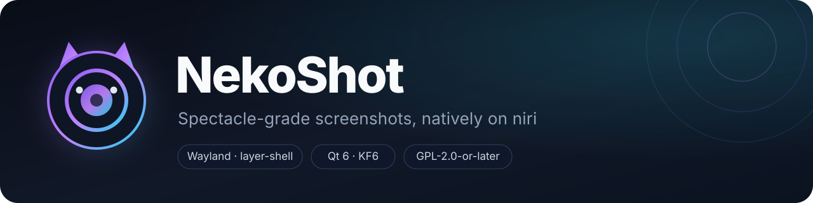
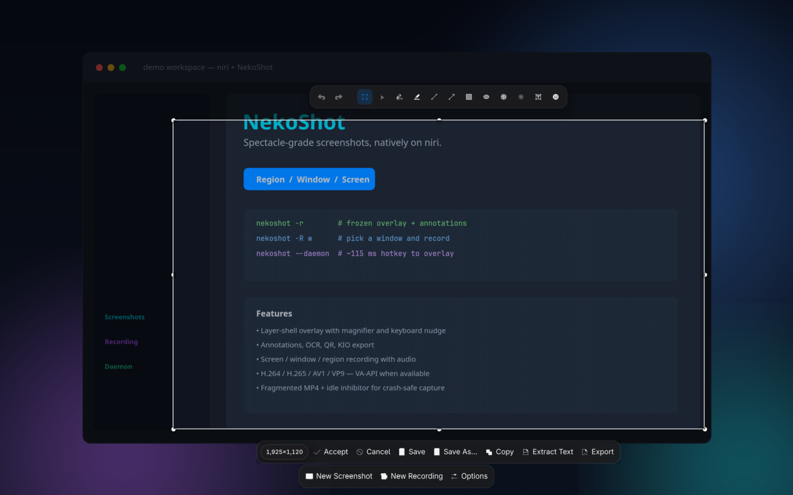
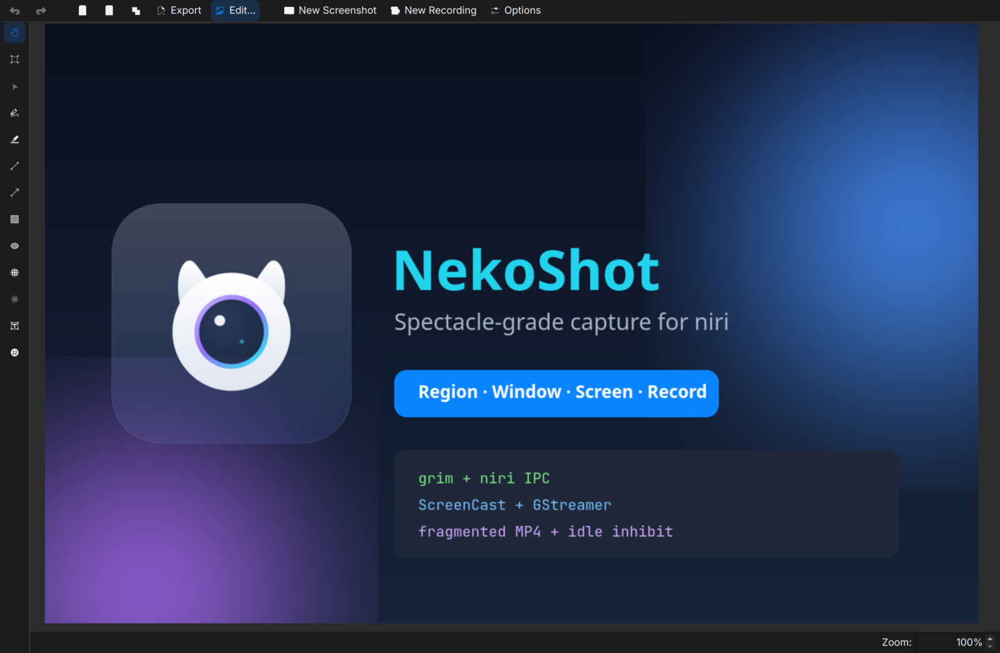
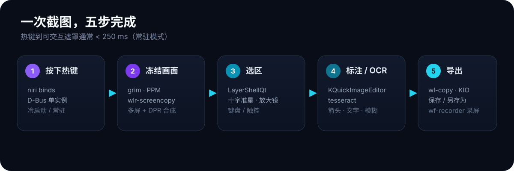
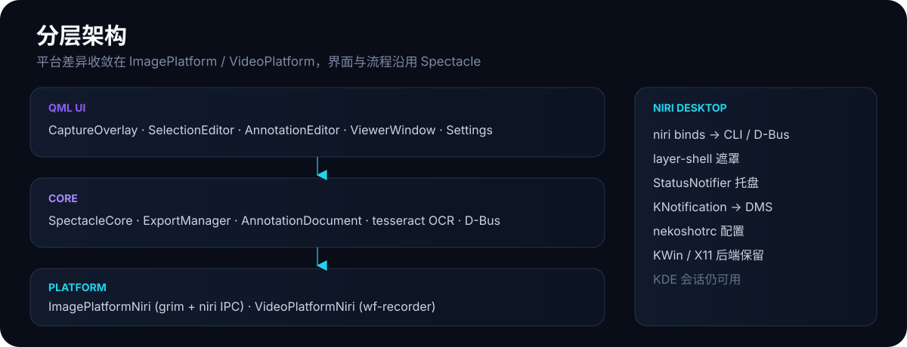

<div align="center">
  

  <h1>NekoShot</h1>

  <p><b>为 niri 而生的 Spectacle 级截图与录屏工具</b></p>

  <p>
    <a href="https://github.com/NekoRain404/NekoShot/releases/latest"></a>
    <a href="https://github.com/NekoRain404/NekoShot/actions/workflows/build.yml"></a>
    
    
    
    
  </p>

  <p>简体中文 · <a href="README.en.md">English</a></p>
</div>

> **NekoShot 参考并移植自 [KDE Spectacle](https://invent.kde.org/graphics/spectacle) 6.8.80。**
> 它保留了 Spectacle 的遮罩、选区编辑、标注、OCR、导出与预览流程，把只属于 KWin 的抓屏层替换为 `grim` + niri IPC；
> Screen / Window / Region 录屏优先使用 niri Mutter ScreenCast + GStreamer，仅在跨输出或无 GStreamer 时回退 `wf-recorder`。
> NekoShot 不是 KDE 官方项目，与 KDE e.V. 没有隶属关系；所有上游代码与设计归功于 Spectacle 及其贡献者。

NekoShot（猫 + Shot）解决的是很具体的问题：在 niri 这种没有 KDE 服务的 Wayland 合成器上，也能拥有
"按下快捷键、框选、标注、复制或保存"的一气呵成，而不是在 `grim | slurp | satty` 之间来回切换。

它不重写轮子：抓屏用 `grim`，窗口识别用 niri IPC，标注沿用 KQuickImageEditor，OCR 用 tesseract；
录屏用 niri 的 Mutter ScreenCast + GStreamer，区域也优先走 ScreenCast + `videocrop`，因此可以包含指针、
系统声/麦克风，并使用 VA-API 硬件编码。

---

## 界面

<p align="center">
  
  
</p>
<p align="center">
  <sub><b>左：</b>冻结的 layer-shell 遮罩 + 选区 + 标注工具栏；<b>右：</b>预览、标注与导出。</sub>
</p>

## 目录

- [功能亮点](#功能亮点)
- [安装](#安装)
- [快速开始](#快速开始)
- [命令行](#命令行)
- [录屏](#录屏)
- [性能](#性能)
- [稳健性](#稳健性)
- [已知限制](#已知限制)
- [架构与项目结构](#架构与项目结构)
- [开发与测试](#开发与测试)
- [与 Spectacle 的关系](#与-spectacle-的关系)
- [许可证与致谢](#许可证与致谢)

## 功能亮点

| 能力 | NekoShot |
|---|---|
| 截图模式 | 区域、全屏、当前屏、活动窗口、鼠标下窗口（niri 原生拾取）、全屏缩放 |
| 冻结遮罩 | 真正的 wlr-layer-shell surface，不进入平铺、不切换工作区；沿用 Spectacle 的选区编辑器、放大镜和键盘微调 |
| 标注 | KQuickImageEditor：箭头、文字、矩形、椭圆、高亮、模糊、撤销/重做；颜色弹层内置 HSV 取色 |
| OCR / 二维码 | tesseract C API；二维码沿用上游 Prison |
| 导出 | 复制、保存、另存、路径复制、临时文件拖拽；KIO 目标 |
| 录屏 | 区域 / 屏幕 / 窗口；窗口通过 `niri msg pick-window` 点击选择 |
| 编码 | WebM/VP9、MP4/H.264、MP4/H.265、MP4/AV1；低/中/高 4/10/18 Mbps 质量档 |
| 音频 | 系统声音、麦克风、两者混音（Screen/Window/Region ScreenCast 路径） |
| 指针 | ScreenCast 录屏支持 `cursor-mode`；截图受 niri screencopy 限制（见[已知限制](#已知限制)） |
| 常驻 | `--daemon` + niri binds；QML 预热后热键→遮罩约 0.1 秒 |
| 稳健性 | fragmented MP4、录制期间 idle 抑制、磁盘/只读预检、失败退出码、状态机防重入 |

## 安装

### 直接安装发布包（Arch Linux）

从 [Releases](https://github.com/NekoRain404/NekoShot/releases/latest) 下载最新的
`nekoshot-<version>-1-x86_64.pkg.tar.zst`，然后：

```bash
sudo pacman -U nekoshot-0.10.3-1-x86_64.pkg.tar.zst
```

包会安装二进制、桌面文件、D-Bus/systemd 单元、KConfig schema、通知、翻译、图标和
`nekoshot(1)` man page。NekoShot 与 `spectacle` 包冲突，安装前请先移除或避免同时安装。

### 从源码构建

```bash
git clone https://github.com/NekoRain404/NekoShot.git
cd nekoshot

cmake -S . -B build -G Ninja \
  -DCMAKE_BUILD_TYPE=Release \
  -DWITH_X11=OFF
cmake --build build
ctest --test-dir build --output-on-failure
sudo cmake --install build
```

构建依赖：`cmake ninja extra-cmake-modules qt6-tools wayland plasma-wayland-protocols`。

运行时依赖：`qt6-base qt6-declarative qt6-wayland kcoreaddons kconfig ki18n kguiaddons
kwindowsystem knotifications kdbusaddons kglobalaccel kxmlgui kio kirigami
kstatusnotifieritem prison kcrash kquickimageeditor layer-shell-qt tesseract grim`。

可选依赖：`wf-recorder`（回退）、`gstreamer` + `gst-plugins-good`（ScreenCast 录屏、VP9/Opus、`pulsesrc`）、
`gst-plugins-ugly`（H.264 软件后备 `x264enc`）、`gst-plugin-va`（VA-API 硬件编码）、
`libva-utils`（`vainfo` 能力探测）、`gst-libav`（MP4/AAC）、`tesseract-data-*`（OCR 语言包）、
`kimageformats`、`breeze-icons`。

### Arch 本地打包

```bash
cd packaging
makepkg -si
```

`makepkg` 会运行 CTest，并从当前源码树构建。每个 Release 还附带
`nekoshot-<version>-aur.tar.gz`（AUR `PKGBUILD` + `.SRCINFO`），基于该 Release 的源码包构建；
细节见 [`packaging/README.md`](packaging/README.md)。

## 工作流

<p align="center">
  
</p>

热键由 niri `binds` 提供，NekoShot 通过单实例 D-Bus 接收；遮罩是真正的 wlr-layer-shell
surface，不进入平铺、不切换工作区、不等待窗口动画。抓屏在遮罩显示前完成，遮罩本身不会进入截图。

## 快速开始

推荐在 niri 启动时拉起常驻实例，首次热键不再支付 QML 冷加载：

```kdl
spawn-at-startup "nekoshot" "--daemon"
```

把 [`contrib/niri-binds.kdl`](contrib/niri-binds.kdl) 并入 niri 配置，并删除默认的
`Print { screenshot; }` 以避免冲突。常用绑定：

- `Print` → 区域截图
- `Ctrl+Print` → 全屏
- `Alt+Print` → 当前屏
- `Mod+Shift+S` → 窗口拾取
- `Mod+Shift+R` → 区域录屏
- `Mod+Shift+X` → 停止录制

没有常驻实例也能用：每次调用会启动一次性进程（冷启动约 0.4–0.6 秒）。

## 命令行

命令行与 Spectacle 兼容：

| 命令 | 作用 |
|---|---|
| `nekoshot -r` | 区域截图 |
| `nekoshot -m` | 当前屏幕 |
| `nekoshot -f` | 全部屏幕 |
| `nekoshot -f --scaled` | 全部屏幕，逻辑分辨率 |
| `nekoshot -a` | 活动窗口 |
| `nekoshot -u` | 鼠标下窗口（niri 原生拾取） |
| `nekoshot -l` | 只打开界面 |
| `nekoshot -b` | 后台抓取并退出，不打开预览窗 |
| `nekoshot -o <path>` | 指定输出文件 |
| `nekoshot -d <ms>` | 延时 |
| `nekoshot -p` | 请求包含指针（截图受 niri 限制，见下） |
| `nekoshot -R r\|s\|w` | 开始录屏：区域 / 屏幕 / 窗口 |
| `nekoshot --stop-recording` | 停止当前录制并等待 finalize |
| `nekoshot --daemon` | 常驻，等待 D-Bus 请求 |

D-Bus：`org.nekoshot.NekoShot`，对象路径 `/`，方法名与 Spectacle 一致
（`RectangularRegion`、`ActiveWindow`、`RecordRegion` 等）。

## 录屏

| 模式 | 后端 | 指针 | 音频 | 说明 |
|---|---|---|---|---|
| Screen | Mutter ScreenCast + GStreamer | ✅ `cursor-mode` | ✅ 系统声/麦克风/混音 | 聚焦输出 |
| Window | Mutter ScreenCast + GStreamer | ✅ | ✅ | 点击选择窗口；先校验 GStreamer |
| Region | ScreenCast + `videocrop` | ✅ | ✅ | 完全位于单个输出内时 |
| Region（回退） | `wf-recorder` | ❌ | ✅ 音频参数 | 跨输出、或 GStreamer 不可用 |

格式：

- **WebM**：VP9 + Opus
- **MP4**：H.264/AAC（优先 `vah264enc`，回退 `x264enc`）、H.265/AAC（`vah265enc`）、AV1/AAC（`vaav1enc`）
- **质量档**：低 4 Mbps / 中 10 Mbps / 高 18 Mbps（默认中）

Screen/Window/Region 的 ScreenCast 路径使用 `compositor + videorate` 固定 30 fps，静态窗口也会持续输出重复帧，
不会产生 0.03 秒的单帧文件。窗口录屏通过 `niri msg pick-window` 选择，不需要先手动聚焦。

## 性能

参考环境：单输出 2880×1800 @175%，niri 26.04，Release 构建。

| 场景 | 中位数 |
|---|---:|
| 冷启动 `-b -f` | **445 ms**（5 次：448/436/442/445/447） |
| 冷启动 `-b -a` | **598 ms**（614/598/601/584/588，余量很小） |
| 常驻热键→遮罩（首次） | **245–266 ms** |
| 常驻热键→遮罩（后续） | **~115 ms**（106–127） |

`--daemon` 启动时预加载 QML 引擎和遮罩/标注/预览组件；`NEKOSHOT_PROFILE=1` 可把阶段耗时输出到 journal。
完整数据见 [`docs/validation.md`](docs/validation.md)。

## 稳健性

- **崩溃/强杀**：ScreenCast 录屏使用 fragmented MP4，已写入片段仍可播放；实测 `kill -9` 后保留约 1 秒合法文件。
- **锁屏/DPMS**：录制期间持有 logind idle 抑制（ScreenSaver 回退），防止长录被空闲中断。
- **资源预检**：只读输出目录、剩余空间不足 64 MB 时直接拒绝；编码器输出 0 字节按失败处理。
- **失败可见**：直接 one-shot 的后台截图/录制失败返回退出码 1。
- **状态机**：拾取器等待中 Stop 会取消；finalize 期间二次 Stop 不会杀编码器；剪贴板快照/恢复在进程内串行化。
- **D-Bus 开关**：可关闭第三方截图/录制请求（`[General] dbusRemoteCapture=false`）。

完整故障矩阵、验收证据和剩余风险见 [`docs/robustness.md`](docs/robustness.md)。

## 已知限制

- **截图指针**：niri 的 screencopy 不合成光标；截图设置中的指针选项在 niri 下禁用，`-p` 对截图不生效。录屏通过 `cursor-mode` 支持指针。
- **多屏 / 混合 DPI / 负原点**：代码按每个输出的物理尺寸和图像本地坐标裁剪，负原点不再拒绝，但真实多屏环境尚未做端到端验收，目前只有单元测试覆盖几何换算。
- **Region 跨输出**：回退 `wf-recorder`，失去指针和 ScreenCast 编码；该回退文件不是 fragmented MP4。
- **Window 拾取**：只能选当前可见窗口；没有窗口列表/搜索。
- **录制起始延迟**：ScreenCast/PipeWire 协商可能让文件比等待时间短 4–10 秒；尚无“录制已开始”提示。
- **A/V 起始对齐**：总时长漂移已测（67 秒约 53 ms），首帧音画偏移未测。
- **转发 CLI**：`nekoshot -r` 等请求发给常驻实例后 CLI 先退出，不等待最终保存；`--stop-recording` 返回也不代表文件写完。直接 one-shot 的退出码可靠。
- **D-Bus 默认开放**：默认允许同会话程序触发截图/录制，与 Spectacle 语义一致；可在设置中关闭。
- **分享**：KDE Purpose 分享菜单已移除，专注本地导出。
- **预览/OCR**：预览窗沿用上游，OCR 未做语言级验收。
- **X11/KWin**：KWin/X11 后端保留在源码中，但默认不构建、未做回归；发布包为 Wayland/niri。
- **构建/发布**：PKGBUILD 仍从本地源码树构建，尚未提交 AUR；CI workflow 需要仓库推送后才能实际运行。

## 架构与项目结构

<div align="center">
  
</div>

```text
src/
  Platforms/        niri 截图/录屏后端、ClipboardGuard、IdleInhibitor
  Gui/              QML 遮罩、标注、预览、设置、Widgets 主题
  SpectacleCore.*   抓取/录制编排、D-Bus、导出
  ExportManager.*   图片/视频导出、QR/OCR
tests/              单元测试 + live niri smoke
packaging/          PKGBUILD、AUR 辅助脚本
docs/               设计、验证、稳健性、录屏、上游同步
```

- **界面层**：Spectacle QML 遮罩、选区、标注、预览窗、设置页。
- **核心层**：`SpectacleCore` 负责流程、延时、导出、OCR、D-Bus。
- **平台层**：`ImagePlatformNiri`（grim + niri IPC）、`VideoPlatformNiri`（ScreenCast + GStreamer / wf-recorder）。
- **桌面集成**：niri binds、layer-shell、StatusNotifier、KNotification、`nekoshotrc`。

## 开发与测试

```bash
cmake -S . -B build -G Ninja -DCMAKE_BUILD_TYPE=Release -DWITH_X11=OFF
cmake --build build
ctest --test-dir build --output-on-failure
```

- `ctest` 包含 `filename_test`、`appstreamtest`、`niri_ipc_test`、`niri_capture_test`、`clipboard_guard_test`、`wf_recorder_args_test`，以及 live niri smoke（无 `NIRI_SOCKET` 时 SKIP）。
- GitHub Actions 在 Arch 容器中安装依赖、构建并运行 CTest。
- 提交身份仅使用 **NekoRain**；不要添加工具/AI co-author trailer。详见 [`CONTRIBUTING.md`](CONTRIBUTING.md)。

发布流程：更新版本与 CHANGELOG → `makepkg -f` → `git tag vX.Y.Z` → 推送 → 上传包到 GitHub Release。

## 与 Spectacle 的关系

NekoShot 是 Spectacle 的**下游移植分支**，不是简单重写：

- 基线：Spectacle 6.8.80（上游 commit `d3f3be5`），源码结构与 QML 界面沿用。
- 新增：`ImagePlatformNiri`、`VideoPlatformNiri`、layer-shell 遮罩、niri 热键/常驻、ScreenCast 录屏、稳健性加固。
- 移除：Purpose 分享；默认不构建 X11。
- 保留：GPL-2.0-or-later、上游作者署名、D-Bus/CLI 接口语义。

上游同步策略见 [`docs/upstream.md`](docs/upstream.md)。

## 许可证与致谢

NekoShot 以 **GPL-2.0-or-later** 发布，完整文本见 [`LICENSES/`](LICENSES/)。

感谢：

- **Spectacle** 的作者与贡献者：Boudhayan Gupta、David Redondo、Noah Davis，以及 KDE 社区。
- **KQuickImageEditor**、**KDE Frameworks**、**Qt** 提供界面与标注基础。
- **niri**、**grim**、**wlroots**、**wf-recorder**、**GStreamer/PipeWire**、**tesseract** 提供底层能力。

<div align="center">
  <sub>NekoShot · made for niri · based on Spectacle</sub>
</div>
